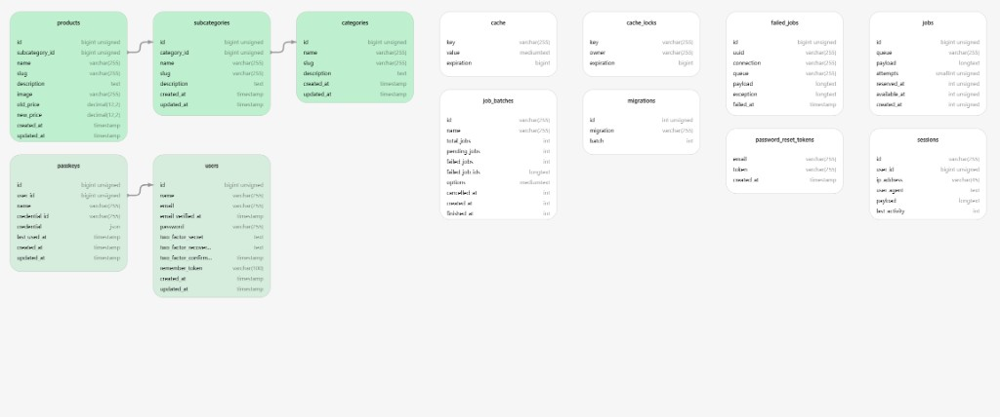

# E-commerce Platform Development

A simplified e-commerce management app built with the **Laravel + Vue + Inertia** starter kit.

**What you can do**

- Admin CRUD for **Categories → Subcategories → Products**
- Product image upload
- Public product catalogue with SEO-friendly slug URLs (`/products/{slug}`)
- Session auth via Laravel Fortify

---

## Reviewer quick start (Docker)

**Requirements:** [Docker Desktop](https://www.docker.com/products/docker-desktop/) (Compose v2). No local PHP, MySQL, or Node required.

### Windows (PowerShell)

```powershell
copy .env.example .env
.\docker\setup.ps1
```

### macOS / Linux

```bash
cp .env.example .env
chmod +x docker/setup.sh
./docker/setup.sh
```

Open **http://localhost**

If port `80` is busy, edit `.env`:

```env
APP_PORT=8080
APP_URL=http://localhost:8080
```

Then run setup again (or `docker compose up -d`).

### Login

| Role  | Email               | Password   |
|-------|---------------------|------------|
| Admin | `admin@example.com` | `password` |
| User  | `test@example.com`  | `password` |

On `/login`, use **Admin login** to auto-fill the admin credentials, then click **Log in**.

### Useful commands

```bash
docker compose up -d
docker compose down
docker compose exec laravel.test php artisan test --compact
docker compose exec laravel.test php artisan migrate:fresh --seed --force
```

---

## What to review (5-minute path)

1. Open `/products` — public catalogue grouped by subcategory  
2. Open a product detail page — slug URL, image, prices  
3. Go to `/login` → Admin login → Dashboard  
4. CRUD: **Categories**, **Subcategories**, **Products**  
5. Create/edit a product — category → subcategory dropdown, image upload  
6. Try deleting a category that still has subcategories (should be blocked)

---

## Tech stack

| Layer        | Choice                                      |
|--------------|---------------------------------------------|
| Backend      | Laravel 13, PHP 8.4, MySQL, Eloquent        |
| Auth         | Laravel Fortify (session)                   |
| Frontend     | Vue 3, TypeScript, Inertia.js v3, Tailwind 4 |
| Validation   | Form Requests                               |
| Tests        | Pest                                        |
| Docker       | Laravel Sail (`compose.yaml`)               |

---

## Architecture

```text
Browser (Vue + Inertia)
        │
   Routes / Controllers  →  Form Requests
        │
   Services (CRUD, images, slugs, catalogue)
        │
   Eloquent Models + MySQL
```

- Controllers stay thin (HTTP only)
- Business logic lives in `app/Services`
- Models hold relations, search scopes, and small helpers
- Products store only `subcategory_id` — category comes from `product → subcategory → category`

---

## Database diagram



### Domain tables (assignment)

```text
categories 1──* subcategories 1──* products
```

| Table           | Purpose |
|-----------------|--------|
| `categories`    | Top-level groups (e.g. Electronics) |
| `subcategories` | Belong to a category (e.g. Mobile Phones) |
| `products`      | Belong to a subcategory; image path + prices |

**Deletion rules**

| Action | Result |
|--------|--------|
| Delete category with subcategories | Blocked |
| Delete subcategory with products | Blocked |
| Delete product | Allowed — image file removed |

**Key product columns:** `name`, `slug` (unique), `description`, `image`, `old_price`, `new_price`

### Framework tables

Starter-kit / Laravel tables (`users`, `sessions`, `cache`, `jobs`, `migrations`, `passkeys`, etc.) support auth and infrastructure. Review focus is the green domain tables above.

Optional SQL dump: `database/ecommerce_platform_development.sql`

---

## Main routes

### Public (no login)

| Method | URI | Description |
|--------|-----|-------------|
| GET | `/` | Redirects to product catalogue |
| GET | `/products` | Catalogue |
| GET | `/products/{slug}` | Product details |

### Admin (`auth` + `verified`)

| Area | URI prefix |
|------|------------|
| Dashboard | `/dashboard` |
| Categories | `/admin/categories` |
| Subcategories | `/admin/subcategories` |
| Products | `/admin/products` |
| Dependent dropdown API | `/admin/categories/{id}/subcategories` |

---

## Project layout

```text
app/
  Http/Controllers/Admin/      # Dashboard, Category, Subcategory, Product
  Http/Controllers/Frontend/   # Public catalogue + detail
  Http/Requests/               # Store/Update validation
  Models/                      # Category, Subcategory, Product, User
  Services/                    # CRUD, storefront, images, slugs
compose.yaml                   # Docker Compose
docker/                        # PHP 8.4 image + setup scripts
database/
  migrations/ factories/ seeders/
  ecommerce_platform_development.sql
docs/database-diagram.png
resources/js/pages/
  admin/…                      # Admin Inertia pages
  frontend/products/           # Public pages
tests/Feature/                 # Pest feature tests
```

---

## Native install (optional)

Use this if you prefer Laravel Herd / local PHP instead of Docker.

```bash
composer install
cp .env.example .env
php artisan key:generate
```

Set MySQL in `.env`:

```env
DB_CONNECTION=mysql
DB_HOST=127.0.0.1
DB_PORT=3306
DB_DATABASE=ecommerce_platform_development
DB_USERNAME=root
DB_PASSWORD=
```

Then:

```bash
php artisan migrate --seed
php artisan storage:link
npm install
npm run build
composer run dev
```

---

## Images

- Stored under `storage/app/public/products`
- DB keeps the relative path only
- Public URL via `php artisan storage:link` → `/storage/...`
- Replace/delete cleans old files (`ProductImageService`)

Seeded demo products use real English names and Unsplash photos (network needed on first `db:seed`).

---

## Testing

```bash
# Docker
docker compose exec laravel.test php artisan test --compact

# Native
php artisan test --compact
```

Covers CRUD, validation, restricted deletes, image upload/replace/delete, public slug pages, and guest blocking on admin routes.

---

## Deployment notes (Linux VPS)

1. Point the web server document root to `public/`
2. PHP 8.4 + extensions: `mbstring`, `pdo_mysql`, `gd`, `fileinfo`, `bcmath`, …
3. Configure production `.env`, then:

```bash
composer install --no-dev --optimize-autoloader
npm install && npm run build
php artisan migrate --force
php artisan db:seed --force
php artisan storage:link
php artisan config:cache route:cache view:cache
```

4. Ensure `storage` and `bootstrap/cache` are writable  
5. Do **not** commit `.env` or secrets

---

## Submission

1. Migrations + seeders run cleanly  
2. Include SQL dump if required (`database/ecommerce_platform_development.sql`)  
3. Zip the project, rename with your full name  
4. Email to `bpcareer3@gmail.com` before **11:59 PM, 08 November 2026**
